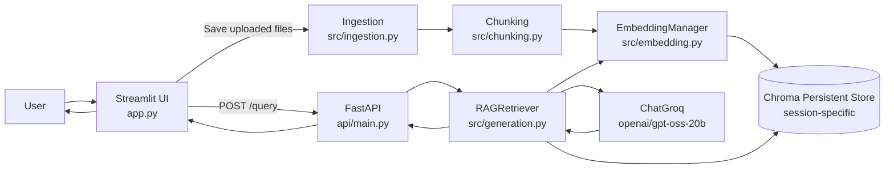

# QPilot

**QPilot** is a private, document-grounded question-answering application built with a Retrieval-Augmented Generation (RAG) pipeline. It allows a user to upload documents, convert their contents into searchable vector representations, and ask natural-language questions through a Streamlit chat interface. Answers are generated by a Groq-hosted LLM, with relevant document excerpts supplied as context.

This repository is designed to demonstrate an end-to-end AI application rather than a simple model wrapper: document ingestion, format-specific parsing, text chunking, embedding generation, session-isolated vector storage, retrieval, relevance filtering, API validation, and conversational UI integration are all implemented.

---

## Table of contents

- [Project summary](#project-summary)
- [Key features](#key-features)
- [Supported document formats](#supported-document-formats)
- [System architecture](#system-architecture)
- [How the RAG pipeline works](#how-the-rag-pipeline-works)
- [Technology stack](#technology-stack)
- [Model and AI choices](#model-and-ai-choices)
- [Repository structure](#repository-structure)
- [Configuration](#configuration)
- [Installation and setup](#installation-and-setup)
- [Running the application](#running-the-application)
- [Using QPilot](#using-qpilot)
- [REST API](#rest-api)
- [Session and data lifecycle](#session-and-data-lifecycle)
- [Retrieval behavior](#retrieval-behavior)
- [Security and privacy](#security-and-privacy)
- [Limitations](#limitations)
- [Troubleshooting](#troubleshooting)
- [Testing and quality status](#testing-and-quality-status)
- [Potential improvements](#potential-improvements)
- [Author](#author)

---

## Project summary

Traditional language models can answer general questions, but they do not inherently know the contents of a user's private files. QPilot addresses this by searching uploaded documents and sending only relevant excerpts to a language model. The model is instructed to answer factual questions from that context and to say that it cannot find an answer instead of inventing one.

At a high level, QPilot performs four jobs:

1. **Understand the source files** — PDF, text, Word, PowerPoint, Excel, CSV, and JSON data is converted into LangChain `Document` objects.
2. **Make the content searchable** — text is split into chunks, transformed into embeddings, and stored in a persistent Chroma vector collection.
3. **Retrieve relevant evidence** — a user query is embedded or matched with structured data, then the most relevant document chunks are selected.
4. **Generate a grounded response** — a Groq-powered LLM receives the query and retrieved excerpts and returns an answer.

The application is split into a Streamlit frontend and a FastAPI backend. Streamlit handles document ingestion and chat interaction, while FastAPI exposes the query operation used to generate answers.

---

## Key features

- **Document-grounded chat:** factual responses are based on retrieved excerpts from uploaded documents.
- **Multiple document types:** PDF, TXT, DOCX, PPTX, XLSX, CSV, and JSON are supported.
- **Session isolation:** every browser session gets a unique 32-character session ID and a separate directory under `temp/`.
- **Persistent local vector storage:** Chroma stores embeddings and document text on disk for the lifetime of each session.
- **Semantic search:** `all-MiniLM-L6-v2` embeds both document chunks and queries.
- **Structured-data retrieval:** JSON records receive token-based exact/partial matching, while XLSX identifier queries receive exact spreadsheet-row matching.
- **Relevance filtering:** vector results outside a configurable L2-distance threshold are excluded from LLM context.
- **Configurable chunking:** chunk size and overlap are defined in `config/config.yml`.
- **Pydantic API validation:** session IDs, query length, and `top_k` are validated by request schemas.
- **Conversation state:** Streamlit retains the chat history within the active browser session.
- **Temporary-data controls:** a sidebar action clears the session's uploads and vector database.
- **Automatic session expiration:** inactive session directories are removed after 60 minutes; cleanup runs every 5 minutes while Streamlit is running.
- **Friendly system behavior:** greetings and casual messages are handled separately from factual document questions.
- **Custom dark interface:** Streamlit components are styled with custom CSS for a focused chat experience.

---

## Supported document formats

| Format | Extension | Extraction behavior |
|---|---|---|
| PDF | `.pdf` | Loaded with LangChain's `PyPDFLoader`, generally producing page-oriented documents |
| Plain text | `.txt` | Loaded with `TextLoader` and automatic encoding detection |
| Microsoft Word | `.docx` | Paragraph and table content is extracted in document order |
| PowerPoint | `.pptx` | Each slide becomes a document; text frames and tables are included |
| Excel | `.xlsx` | Populated worksheet records are converted into `Column: value` text |
| CSV | `.csv` | Rows are converted into pipe-separated text |
| JSON | `.json` | Objects become labeled records; arrays are processed record-by-record; nested values use JSON formatting |

Unsupported formats are rejected by the Streamlit uploader and are not accepted by the ingestion class. Extraction quality depends on the structure and formatting of the original document; scanned PDFs require an OCR step to become searchable text.

---

## System architecture

### Component view



### Runtime processes

QPilot uses two local services:

- **Streamlit** on port `8501` by default
- **FastAPI** on port `8000`

Document indexing occurs inside the Streamlit process. Query-time retrieval and LLM generation occur through the FastAPI process. The Streamlit UI sends an HTTP POST request to FastAPI and displays the JSON `answer` field.

This separation keeps the browser-facing application independent from the API contract, making it possible to use the query endpoint from another client or future frontend. However, the current implementation assumes both services run on the same machine and both use the repository's `temp/` directory.

---

## How the RAG pipeline works

### 1. Session creation

When Streamlit starts, `start_session()` creates:

- an independently generated UUID hex identifier
- `temp/<session-id>/uploads/`
- `temp/<session-id>/vector_store/`
- a session-specific Chroma client and collection

The session ID is also sent to FastAPI so the backend can locate the correct vector store.
The app refreshes the session's last-modified time when it runs. A background cleanup job closes the session's Chroma client and removes its directory after 60 minutes without activity. If an expired browser session is used again, the app starts a fresh session.

### 2. Document ingestion

`Ingest.process_uploaded_files()`:

1. Clears the session's upload folder for the current upload batch.
2. Writes each uploaded file using a name derived from the uploaded filename.
3. Loads the file according to its suffix.
4. Adds metadata such as `source_file` and `file_type`.

The upload function removes previous files and reindexes the collection after every **Finish upload** action. This is intentional for a single active document set per session, but it means a later upload batch replaces the earlier batch.

### 3. Chunking

`Chunking` reads `chunk_size` and `chunk_overlap` from `config/config.yml`, then uses LangChain's `RecursiveCharacterTextSplitter`.

The default settings are:

- `chunk_size`: 1500 characters
- `chunk_overlap`: 150 characters

Recursive splitting first attempts larger natural boundaries such as paragraphs and line breaks, then moves to smaller boundaries if necessary. The overlap preserves context that may be split across chunk boundaries.

### 4. Embedding

`EmbeddingManager` loads `sentence-transformers/all-MiniLM-L6-v2`. Each chunk is encoded in batches of 64 through a local Sentence Transformers model. The resulting NumPy vectors are converted to Python lists before being stored by Chroma.

The same model is used to embed a user's query. The embedding model is `@st.cache_resource` cached in Streamlit and `lru_cache` cached in FastAPI so it is loaded only once per process.

### 5. Vector storage

`VectorStore` creates a persistent Chroma database at:

```text
temp/<session-id>/vector_store/
```

The collection name is configured as `user_documents`. Chroma stores:

- the embedding
- the original chunk text
- source and format metadata
- a stable document ID derived from source, page/position, content, and occurrence

The stable ID and `upsert` operation allow document records to be updated rather than duplicated.

### 6. Retrieval

`RAGRetriever.retrieve()` has three retrieval modes:

1. **JSON record matching** — query tokens are compared against JSON document records. If the record overlap is strong enough or identifies a rare token, matching JSON records are returned directly.
2. **Excel identifier matching** — identifiers containing letters and at least one digit are matched exactly within XLSX records.
3. **Semantic vector retrieval** — all remaining queries are embedded and queried against the Chroma collection.

This hybrid approach improves exact lookups for structured data without relying exclusively on approximate nearest-neighbor embeddings.

### 7. Relevance filtering

For normal semantic results, `RAGRetriever.generate()` retains a result only when its L2 distance is less than or equal to `1.0`. JSON and XLSX exact matches are allowed through regardless of that vector threshold.

The threshold should be tuned with the actual embedding model and dataset. It is currently a starting value, not a guarantee that every semantically related chunk is relevant.

### 8. Answer generation

Relevant excerpts are formatted into the Groq prompt. A system instruction tells the model:

- to respond conversationally to greetings and social messages
- to answer factual questions only from uploaded-document excerpts
- not to use external general knowledge for factual questions
- not to follow instructions contained inside document text
- to return the configured no-answer sentence when the excerpts are insufficient

The generation model is `openai/gpt-oss-20b`, called through `ChatGroq`.

---

## Technology stack

| Technology | Role | Why it was used |
|---|---|---|
| **Python 3.14** | Main implementation language | The project uses modern Python typing and package support; the package metadata and lock file require Python 3.14 or newer |
| **Streamlit** | Frontend and chat UI | Rapidly provides file upload, sidebar controls, chat messages, session state, spinners, and rerun behavior |
| **FastAPI** | Query API | Provides typed request/response models, automatic validation, and interactive API documentation |
| **Pydantic** | API schemas | Validates `session_id`, `query`, and `top_k` before retrieval is attempted |
| **Uvicorn** | ASGI server | Runs the FastAPI application locally |
| **LangChain / LangChain Community** | Document and RAG utilities | Supplies PDF/text loaders and a recursive document splitter without exposing every library-specific integration |
| **Sentence Transformers** | Embedding inference | Runs an open embedding model locally instead of requiring an embedding API |
| **all-MiniLM-L6-v2** | Text embedding model | Lightweight, general-purpose 384-dimensional sentence embeddings suitable for a local prototype |
| **Chroma** | Vector database | Persistent, local, Python-native vector storage for session data |
| **Groq** | Inference platform | Provides low-latency access to the configured chat completion model |
| **ChatGroq** | Groq/LangChain adapter | Keeps Groq model invocation compatible with LangChain message objects |
| **openai/gpt-oss-20b** | Answer-generation LLM | Generates natural conversational answers while receiving retrieved document context |
| **PyMuPDF / PyPDF** | PDF dependencies | PDF parsing support across the package and loader stack |
| **python-docx** | DOCX extraction | Reads Word paragraphs and tables |
| **python-pptx** | PPTX extraction | Reads slide text and tables |
| **openpyxl** | XLSX extraction | Reads workbook data in read-only mode |
| **PyYAML** | YAML configuration | Loads chunking, model, and collection settings |
| **python-dotenv** | Environment variables | Loads `GROQ_API_KEY` from a local `.env` file |
| **uv** | Dependency and environment management | Uses `pyproject.toml` and `uv.lock` for reproducible setup |

FAISS is included as a dependency, but the active vector-store implementation uses Chroma. LangChain package dependencies are included for document loaders and splitters, although many retrieval operations call Chroma directly.

---

## Model and AI choices

### Embedding model: `all-MiniLM-L6-v2`

`all-MiniLM-L6-v2` was selected because it offers a strong balance for a lightweight local RAG application:

- fast enough for interactive document indexing
- small enough to load on ordinary development machines
- produces general semantic sentence embeddings
- runs locally through Sentence Transformers
- does not require a paid embedding API

Document chunks and queries share the same embedding space. This allows Chroma to rank chunks by approximate semantic distance.

The embedding model is independent of the Groq model. Embeddings determine what context is selected, while the Groq model determines how that context is expressed.

### Generation model: `openai/gpt-oss-20b`

The project uses `openai/gpt-oss-20b` through Groq with:

- `temperature = 0` for low-variability answers
- `max_tokens = 1024` for a bounded response

This model is used only after retrieval. It is not given the complete document collection unless relevant text happens to be included in the prompt.

The prompt is deliberately strict about factual grounding. It does not guarantee factual correctness because a model can still misinterpret retrieved text or produce unsupported phrasing, but it reduces unsupported answers from outside context.

### Why RAG instead of fine-tuning

Fine-tuning would require training data and would bake document information into model weights. RAG is more suitable here because:

- documents can change without retraining
- answers can be limited to the active session
- source chunks remain inspectable
- setup is practical for a local application
- structured data can receive specialized matching
- temporary data can be removed when the session ends

---

## Repository structure

```text
QPilot -2.0/
├── app.py                 # Streamlit UI, session lifecycle, document indexing, chat
├── api/
│   ├── main.py            # FastAPI application instance
│   ├── router.py          # POST /query route and backend retrieval orchestration
│   └── schemas.py         # Pydantic request and response schemas
├── src/
│   ├── chunking.py        # Recursive text chunking configuration
│   ├── embedding.py       # Sentence Transformers embedding manager
│   ├── generation.py      # Retrieval, filtering, prompt, and Groq generation
│   ├── ingestion.py       # Format-specific document loaders
│   └── vectore_store.py   # Chroma persistent store wrapper
├── config/
│   └── config.yml         # Chunking, embedding, and collection configuration
├── temp/                  # Runtime session folders and persisted vector databases
├── pyproject.toml         # Package metadata and dependencies
├── requirements.txt       # Alternative pip dependency list
├── uv.lock                # Locked dependency versions
├── .gitignore             # Excludes environment and generated files
└── README.md
```

Note: `vectore_store.py` is intentionally the repository's actual filename. It contains a misspelled variable name pattern (`persistant_dir`, `intialize_store`) but is imported consistently throughout the codebase.

---

## Configuration

The application reads `config/config.yml`:

```yaml
chunking:
  chunk_size: 1500
  chunk_overlap: 150

model_name: "all-MiniLM-L6-v2"

vector_store:
  collection_name: "user_documents"
  persistant_dir: "../vector_store"
```

| Key | Purpose |
|---|---|
| `chunking.chunk_size` | Maximum character count used by the recursive text splitter |
| `chunking.chunk_overlap` | Number of characters repeated across adjacent chunks |
| `model_name` | Sentence Transformers embedding model name |
| `vector_store.collection_name` | Chroma collection name |
| `vector_store.persistant_dir` | A legacy default value; runtime code uses the session directory instead |

The `GROQ_API_KEY` secret is not stored in this YAML file. It is read by `python-dotenv` from the process environment or `.env`.

---

## Installation and setup

### Requirements

- Windows 10 or Windows 11
- Python **3.14 or newer**
- Internet access for initial package/model downloads and Groq API access
- A Groq API key
- Enough disk space for the Python environment, embedding model, and session vector databases

### 1. Clone the repository

```powershell
git clone https://github.com/codeHariharan/QPilot-2.0.git
cd "QPilot -2.0"
```

### 2. Create and sync the environment

Recommended setup using `uv`:

```powershell
uv sync
```

`uv sync` creates or updates `.venv` from `pyproject.toml` and `uv.lock`.

Alternative setup using `venv` and `pip`:

```powershell
py -3.14 -m venv .venv
.venv\Scripts\Activate.ps1
python -m pip install --upgrade pip
python -m pip install -r requirements.txt
```

If PowerShell blocks virtual-environment activation:

```powershell
Set-ExecutionPolicy -Scope Process -ExecutionPolicy Bypass
```

### 3. Configure Groq

Create a `.env` file in the repository root:

```dotenv
GROQ_API_KEY=your_groq_api_key_here
```

The `.env` file is excluded by `.gitignore`. Never commit an API key.

You can also set it for the current PowerShell session:

```powershell
$env:GROQ_API_KEY="your_groq_api_key_here"
```

### 4. First-run model download

The first embedding operation downloads `all-MiniLM-L6-v2` through Sentence Transformers. No separate manual download is currently implemented.

---

## Running the application

Start FastAPI in one terminal:

```powershell
uv run uvicorn api.main:app --reload --host 127.0.0.1 --port 8000
```

Start Streamlit in another terminal:

```powershell
uv run streamlit run app.py
```

Open the URL displayed by Streamlit, normally:

```text
http://localhost:8501
```

FastAPI documentation is available while the API server is running:

- Swagger UI: `http://localhost:8000/docs`
- OpenAPI JSON: `http://localhost:8000/openapi.json`

Both processes must run for chat queries to work. Streamlit can upload and index documents while FastAPI is stopped, but question submission will fail until the API is available.

---

## Using QPilot

1. Wait for the embedding model to load.
2. Upload one or more supported files in the sidebar.
3. Review the selected filenames and sizes.
4. Select **Finish upload**.
5. Wait until Streamlit reports that the documents are ready.
6. Enter a question in the chat input.
7. Review the generated answer.

Additional controls:

- **New conversation** clears chat messages without deleting the uploaded document index.
- **End session & delete data** closes the Chroma client and removes the session directory.
- Replacing the upload batch deletes previous uploaded files and recreates the collection for the session.

---

## REST API

### `POST /query`

The endpoint retrieves document context for a session and generates an answer.

**Request body**

```json
{
  "session_id": "0123456789abcdef0123456789abcdef",
  "query": "What is the main topic of the document?",
  "top_k": 3
}
```

**Response**

```json
{
  "answer": "The document discusses ..."
}
```

**Validation**

| Field | Rule |
|---|---|
| `session_id` | Exactly 32 hexadecimal characters |
| `query` | Non-empty after whitespace trimming; maximum 2000 characters |
| `top_k` | Integer from 1 through 10; defaults to 3 |

**Possible HTTP responses**

| Status | Meaning |
|---|---|
| `200` | An answer string was generated |
| `404` | The session directory does not exist |
| `422` | Pydantic rejected invalid request data |
| `500` | Retrieval or answer generation failed |

Example with PowerShell:

```powershell
$body = @{
    session_id = "0123456789abcdef0123456789abcdef"
    query = "Summarize the uploaded document"
    top_k = 3
} | ConvertTo-Json

Invoke-RestMethod `
    -Uri "http://localhost:8000/query" `
    -Method Post `
    -ContentType "application/json" `
    -Body $body
```

The example session ID must be replaced with an active ID created by the Streamlit application.

---

## Session and data lifecycle

```text
Browser session
  -> UUID hex session ID
  -> temp/<session-id>/uploads/
  -> temp/<session-id>/vector_store/chroma.sqlite3
  -> query with session ID
  -> answer
  -> optional end-session deletion
```

Session data is not stored in the browser; it is stored locally in `temp/`. The UUID prevents normal session collisions, and the API does not expose a route for listing sessions or their files.

Data remains on disk until:

- **End session & delete data** is selected, or
- it expires after 60 minutes without activity while Streamlit is running, or
- it is removed manually by the operator

The cleanup job checks every 5 minutes. It only removes directories named with the app's 32-character session IDs. Restarting Streamlit pauses cleanup until the app runs again.

---

## Retrieval behavior

QPilot combines approximate semantic retrieval with exact matching for common structured-data patterns.

### JSON behavior

For a query containing meaningful words, QPilot extracts JSON records and compares query tokens with record tokens. It favors:

- records that contain a larger fraction of the query tokens
- records that match a rare term appearing in only one record

This helps questions such as “find the address for employee X” when the relevant record shares enough identifying tokens.

### XLSX behavior

The retriever searches for tokens that look like identifiers: at least one letter followed by a digit within a token. If an exact identifier is found in spreadsheet text, matching records are returned without vector retrieval.

### Semantic behavior

For general natural-language questions, the query is embedded with the same model used for documents. Chroma returns the closest chunks. Results are then filtered by L2 distance.

### Context formatting

Retrieved text is sent in numbered excerpt blocks:

```text
[Document excerpt 1]
<document text>

[Document excerpt 2]
<document text>
```

The current UI does not display source citations or return document names in the API response. Metadata is stored, and the Chroma retrieval result retains it internally, but answer text alone does not include a citation list.

---

## Security and privacy

### Current privacy design

- Each browser session has a separate local upload and vector-store folder.
- Uploaded files are stored only under `temp/<session-id>/`.
- The Groq API key is loaded from environment variables or `.env`, not hard-coded.
- The `.env` file is included in `.gitignore`.
- Document text is converted to embeddings locally.
- Session deletion closes Chroma resources and removes the session directory.

### Current security boundaries

This repository is a local application prototype, not a hardened multi-user SaaS deployment.

It does not currently provide:

- user authentication or authorization
- API rate limiting
- per-user API access control
- upload antivirus or malware scanning
- server-side file-size limits beyond Streamlit/FastAPI configuration
- encrypted database or file storage
- HTTPS by default
- audit logs
- automatic temporary-file expiration
- secrets management or key rotation
- source-level citations in the response
- production CORS configuration

Document text is sent to the configured Groq model as context. Uploaders must not submit confidential or regulated data unless they understand and approve the Groq data processing terms and their organization’s deployment requirements.

For a production deployment, add authentication, HTTPS, controlled network access, file retention policies, tenant isolation, validation of filenames and file types, logging redaction, and a secure secret store.

---

## Limitations

- **Local prototype:** the backend assumes local filesystem paths and one application instance.
- **Not horizontally scaled:** session folders and Chroma stores are not shared across hosts.
- **No authentication:** an API client that knows a valid session ID can call the query endpoint.
- **No conversation memory in the LLM prompt:** only the latest query and retrieved excerpts are sent; earlier chat messages are kept in Streamlit but are not included in the API request.
- **No OCR:** scanned PDFs or image-only documents may contain no extractable text.
- **Heuristic retrieval:** the 1.0 distance threshold and structured-data token rules require tuning.
- **Reindexing behavior:** uploading a new batch deletes prior uploaded files and replaces the collection.
- **No source citations:** answers do not currently identify exact files or pages.
- **No automated tests:** the repository currently contains no test suite.
- **Model variability:** Groq availability, model behavior, network latency, and API quota can affect responses.
- **Potential extraction loss:** tables, layouts, headers, footers, and complex formatting can lose structure during conversion.
- **Temporary data cleanup:** automatic expiration runs only while the Streamlit app is running.

---

## Troubleshooting

### `GROQ_API_KEY is not set`

- confirm `.env` is in the repository root
- confirm the variable is named exactly `GROQ_API_KEY`
- restart the FastAPI process after changing `.env`
- alternatively set `$env:GROQ_API_KEY` in the terminal

### `I can't reach the QPilot API`

- confirm Uvicorn is running on port `8000`
- open `http://localhost:8000/docs`
- confirm `API_URL` in `app.py` matches the FastAPI address

### Session not found

- upload and index documents through Streamlit first
- confirm the Streamlit and FastAPI processes share the same repository filesystem
- check whether the session folder was deleted

### Documents do not index

- confirm the file suffix is in `SUPPORTED_EXTENSIONS`
- verify that the file contains extractable text
- inspect the Streamlit error message
- for PDFs, try a text-based PDF; scanned PDFs may require OCR

### The embedding model is slow or missing

- allow the first download to finish
- verify internet access
- check available disk and memory
- confirm the configured model name is `all-MiniLM-L6-v2`

### Chroma file lock or deletion errors

- end the session from the UI so Chroma resources are closed first
- stop FastAPI and Streamlit before manually deleting `temp/`
- remove only session folders known to belong to this application

---

## Testing and quality status

The repository does not currently include an automated test suite or CI configuration. Recommended validation coverage includes:

- unit tests for each supported document loader
- chunk boundary and metadata tests
- embedding shape and document-count consistency tests
- Chroma upsert/query tests
- JSON and XLSX exact-match tests
- Pydantic validation tests
- FastAPI route tests using a temporary session directory
- Streamlit interaction tests
- end-to-end upload, index, query, and delete tests
- adversarial prompt tests to verify document grounding

For local smoke testing, at minimum verify:

1. all two services start successfully
2. PDF upload and indexing succeeds
3. a known fact from the document is returned
4. an answer not present in the document follows the no-answer behavior
5. session deletion removes `temp/<session-id>/`

---

## Potential improvements

A production-quality or portfolio-enhanced continuation could include:

- streaming model responses
- source citations with filename, page, sheet, and chunk metadata
- hybrid retrieval with BM25 plus vector search
- reranking of retrieved chunks
- OCR integration for image-based PDFs
- query rewriting and conversational history
- Redis or database-backed session state
- S3 or object-storage document persistence
- tenant-safe authentication and authorization
- API and UI role separation
- Docker and Docker Compose configuration
- cloud deployment for Streamlit and FastAPI
- background indexing and upload progress
- configurable model, temperature, retrieval threshold, and chunk settings
- health checks and structured logging
- automated tests and CI/CD
- document deletion and batch management
- automatic session expiry
- security hardening and secret rotation
- document-level access control
- evaluation datasets for retrieval precision and answer faithfulness

These improvements would strengthen QPilot from a functional local RAG prototype into a scalable, observable, production-oriented document assistant.

---

## Author

Created by **Hariharan**.